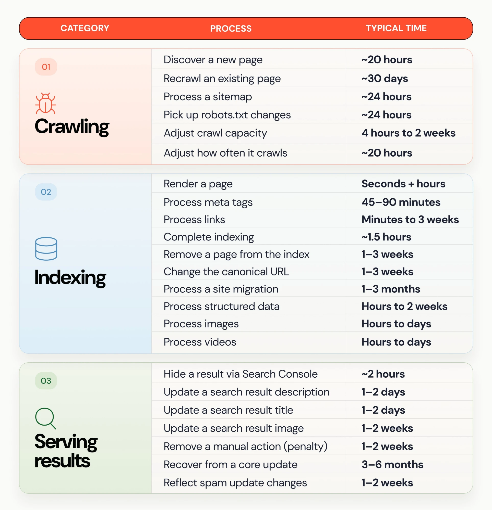

# SEO Links

A curated SEO toolkit for indie founders: research demand, fix technical issues, publish useful pages, build authority and measure visibility across search and AI answers.

> Browse by the job you need to do. Expand a group for its tools, articles or submission destinations.

The export contains **48 SEO source posts**, grouped into **46 source records**. After relevance review, **27 selected resources from the export**, plus **1 supplemental article**, appear below. Directory posts are merged into one destination index.

Relevant articles use a link and a short takeaway. Partial supplied text stays labelled partial; the full article is not copied into the guide.

## Contents

- [SEO Websites, Tools, Skills and GitHub Repos](#seo-websites-tools-skills-and-github-repos)
- [Keyword Research](#keyword-research)
- [Technical SEO](#technical-seo)
- [Content and On-Page SEO](#content-and-on-page-seo)
- [Backlinks and Authority](#backlinks-and-authority)
- [Backlink Opportunities and DR](#backlink-opportunities-and-dr)
- [AI Search and GEO](#ai-search-and-geo)
- [SaaS and App SEO](#saas-and-app-seo)
- [Automation and Skills](#automation-and-skills)
- [Review Coverage](#review-coverage)

---

## SEO Websites, Tools, Skills and GitHub Repos

A single index of the reviewed SEO websites, tools, MCP integrations, reusable skills and source repositories. Expand the groups below; each project is listed once by its main purpose. Submission directories remain in [Backlink Opportunities and DR](#backlink-opportunities-and-dr).

<strong>Measurement and Local Search</strong> - 5 tools

- [Google Search Console](https://search.google.com/search-console/about) - Query, click, impression and indexing reports.
- [Google Analytics](https://marketingplatform.google.com/about/analytics/) - Measure visitors and conversions after the click.
- [Google Business Profile](https://www.google.com/business/) - Manage local business information on Google.
- [Bing Webmaster Tools](https://www.bing.com/webmasters/about) - Review search performance, crawl and indexing information for your registered sites.
- [Google Merchant Center](https://business.google.com/us/merchant-center/) - Manage product data and eligible product listings across Google surfaces.

<strong>Keyword Research and Competitors</strong> - 10 resources

- [Google Trends](https://trends.google.com/trends/) - Explore interest by topic, location and time.
- [Ahrefs](https://ahrefs.com/) - Keyword, competitor and backlink research.
- [Semrush](https://www.semrush.com/) - SEO research, audits and visibility tracking.
- [Ubersuggest](https://neilpatel.com/ubersuggest/) - Keyword and competitor research; [apps and integrations](https://app.neilpatel.com/en/apps-integrations) is the current destination of the supplied aitools.neilpatel.com link.
- [Mangools](https://mangools.com/) - Keyword, SERP, backlink and rank-tracking tools.
- [SE Ranking](https://seranking.com/) - Keyword research, rank tracking and site audits.

- [Keyword Tool](https://keywordtool.io/) - Find autocomplete-based keyword ideas across search platforms; advanced metrics depend on the plan.
- [SpyFu](https://www.spyfu.com/) - Research competitor organic keywords, ranking history and backlink opportunities; vendor estimates are not first-party analytics.
- [Majestic](https://majestic.com/) - Inspect backlinks, referring domains and link context; its proprietary scores are not Google ranking scores.
- [Similarweb](https://www.similarweb.com/) - Explore competitor traffic and channel research; use external measurements for context alongside your own analytics.

<strong>Technical Audits and Automation</strong> - 9 resources

- [Screaming Frog SEO Spider](https://www.screamingfrog.co.uk/seo-spider/) - Crawl pages to inspect technical SEO issues.
- [DataForSEO](https://dataforseo.com/) - SEO data APIs for repeatable research workflows.
- [Index My Site](https://indexmysite.app/) - Bulk URL submissions and indexing-job tracking. Indexing is Google's decision.

- [Seobility](https://www.seobility.net/en/) - Website audits, rank monitoring and backlink analysis; review current plan limits.
- [Screpy](https://screpy.com/) - Website audits, rank tracking, performance monitoring and SEO reporting.
- [Raven Tools](https://raventools.com/) - Site auditing, rank tracking, backlink research and reporting.
- [SiteOne Crawler](https://github.com/janreges/siteone-crawler) - Open-source crawler that scans a whole site for 404s, redirects, SEO tags, performance and security issues, with exportable reports.
- [lychee](https://github.com/lycheeverse/lychee) - Open-source broken-link checker for Markdown, HTML and websites; can run in GitHub Actions.
- [Gatus](https://github.com/TwiN/gatus) - Open-source, self-hosted status monitor that checks API status, response times and SSL certificates and alerts on failures.

<strong>Choosing a Toolkit</strong> - 1 resource

- [Build an SEO toolkit around the work you need to do](https://x.com/seo_bint_ejamil/status/2108267666855416056) - Start with Search Console, Analytics, a crawler and Business Profile; add paid research tools when the strategy needs them.

<strong>GitHub Repositories and Self-Hosted SEO</strong> - 8 resources

- [OpenSEO](https://github.com/every-app/open-seo) - Self-hosted keyword research, rank tracking, competitor insights, backlinks, site audits and AI visibility; includes an MCP server and agent skills. Requires a DataForSEO API key and paid usage; [MCP setup](https://openseo.so/docs/mcp).
- [Jev SEO](https://github.com/AgriciDaniel/jev-seo) - Local SEO crawler and audit-report generator, usable as a CLI or Claude Code skill. Produces PDF, spreadsheet and Markdown reports. Jev judgments require TypeSafe API access; optional extended research uses paid DataForSEO. Audit scores are heuristics, not ranking predictions.

- [advertools](https://github.com/eliasdabbas/advertools) - Python library for crawling, sitemap and robots.txt analysis, URL processing and server-log analysis. Some integrations require separate provider access.
- [GEO/AEO Tracker](https://github.com/danishashko/geo-aeo-tracker) - Self-hosted dashboard for prompts, brand mentions and citations. Live tracking uses Bright Data; analysis may use OpenRouter and other paid APIs. Demo mode uses sample data, and its heuristic scores are not ranking factors.
- [ai-crawler-bots](https://github.com/TryGeoSuite/ai-crawler-bots) - Node CLI and GitHub Action for robots.txt checks, live reachability and log analysis. Treat its visibility score as a heuristic; check current operator documentation rather than adopting its default bot policies blindly.
- [SEOnaut](https://github.com/StJudeWasHere/seonaut) - Open-source website SEO diagnostic tool that checks for issues such as broken links, redirects and duplicate meta tags. Self-hosted; not installed or tested here.
- [SerpBear](https://github.com/towfiqi/serpbear) - Self-hosted keyword rank tracker that monitors changes in Google rankings over time. Not installed or tested here.
- [SEO Machine](https://github.com/TheCraigHewitt/seomachine) - Claude Code workspace for SEO content workflows, including batch planning and optimizing articles. Review generated content before publishing; not installed or tested here.

<strong>Reusable SEO Skills</strong> - 4 collections

- [OpenSEO Agent Skills](https://openseo.so/docs/skills/setup) - Workflows for keyword research and clustering, competitor analysis, local SEO, link prospecting and audits. Requires a working OpenSEO MCP connection; [skill source files](https://github.com/every-app/open-seo/tree/main/plugins/openseo/skills). The keyword-research skill was inspected directly.
- [Jev SEO skill workflow](https://github.com/AgriciDaniel/jev-seo/blob/main/SKILL.md) - Workflow for running the audit, checking surprising findings and producing reports. Uses the Jev SEO repo above and its API/dependency setup. Review model-generated judgments before acting on them.

- [NotFair Plugin](https://github.com/nowork-studio/notfair-plugin) - SEO and analytics workflows for audits, keyword research, sitemaps, local SEO and content. Former NotFair and toprank links resolve to this one repo. Live account workflows need its OAuth-connected MCP and authorized provider access; live workflows not runtime-tested.
- [SEOmator Audit Skill](https://github.com/seo-skills/seo-audit-skill) - Open-source SEO audit CLI and Claude Code skill covering technical SEO, Core Web Vitals, structured data, accessibility, security headers, content quality and AI/GEO readiness, with console, JSON, HTML, Markdown and LLM-oriented reports. MIT; needs Node.js 20.3+ and a local Chrome/Chromium for Core Web Vitals. The README and About text give different rule counts, and scores are heuristics. Documentation read; not runtime-tested.

<strong>SEO Reference Websites and Validators</strong> - 6 resources

- [Google Search Central](https://developers.google.com/search/docs) - Official documentation for crawl access, indexing, content, structured data and search appearance. See the [selected official references](#official-references).
- [Schema Markup Validator](https://validator.schema.org/) - Check Schema.org markup syntax and vocabulary; validation does not establish rich-result eligibility or ranking benefits.
- [Bing Webmaster API documentation](https://learn.microsoft.com/en-us/bingwebmaster/) - Documentation for registered-site search and indexing data.

- [Schema.org vocabulary](https://schema.org/docs/schemas.html) - Look up structured-data types and properties; Schema.org vocabulary is broader than Google's supported rich-result types.
- [Open Graph protocol](https://ogp.me/) - Reference for social-preview metadata; distinct from Google structured-data eligibility.
- [Nu Html Checker](https://validator.github.io/validator/) - Free checker for HTML, CSS and SVG errors; runs online or locally for batch checks.

<strong>Performance and Accessibility</strong> - 4 resources

- [PageSpeed Insights](https://pagespeed.web.dev/) - Inspect page performance and available real-user data; a test score is not a ranking guarantee.
- [GTmetrix](https://gtmetrix.com/) - Analyze page loads, request waterfalls and performance changes; account and plan limits apply.
- [WAVE](https://wave.webaim.org/) - Find accessibility issues and support manual evaluation; automated checks cannot establish complete compliance.
- [Unlighthouse](https://unlighthouse.dev/) - Runs Lighthouse across an entire site to find the pages dragging performance down.

<strong>Browser Extensions</strong> - 2 resources

- [Keyword Surfer](https://surferseo.com/keyword-surfer-extension/) - View keyword ideas and volume estimates in search results, with keyword collections and CSV export.
- [META SEO inspector](https://www.omiod.com/meta-seo-inspector/) - Inspect page metadata and identify missing or inconsistent on-page information.

<strong>Structured Data and Metadata</strong> - 1 resources

- [Google Rich Results Test](https://search.google.com/test/rich-results) - Test URLs or code for supported Google rich-result markup; a valid test does not guarantee display.

<strong>SEO Learning and Updates</strong> - 2 resources

- [Google Search Central Blog](https://developers.google.com/search/blog) - Official search announcements and documentation updates.
- [Ahrefs Blog](https://ahrefs.com/blog/) - Research and practical SEO tutorials from the tool provider; distinguish studies, opinions and current search-engine requirements.

<strong>More SEO Resource Collections</strong> - 2 resources

- [teles/awesome-seo](https://github.com/teles/awesome-seo) - Broad discovery list of SEO tools and references; individual listings and claims need their own checks.
- [bmpi-dev/awesome-seo](https://github.com/bmpi-dev/awesome-seo) - SEO learning and tool collection with English and Chinese resources; includes older material and non-SEO monetization topics.

### SEO MCP Servers

MCP lets an assistant use connected tools and data. These **six integrations** cover search performance, analytics, SEO data and page research. Provider documentation was reviewed on 11 October 2026; the servers have not been installed or tested here. Official and community projects are labelled separately.

<strong>Search Performance and Measurement</strong> — 2 resources

- [Google Search Console MCP](https://github.com/AminForou/mcp-gsc) - **Community.** Analyze queries, clicks, impressions and URL indexing; the server also includes property and sitemap management tools. Google credentials and access to the relevant Search Console property.
- [Google Analytics MCP](https://github.com/googleanalytics/google-analytics-mcp) - **Official / experimental.** Read Analytics account and property information and run reports to investigate traffic and outcomes. Google credentials and access to the relevant Analytics property.

<strong>Keyword, Competitor and Backlink Research</strong> — 2 resources

- [Ahrefs MCP](https://docs.ahrefs.com/en/mcp/docs/introduction) - **Official.** Connect Ahrefs research data to an MCP-compatible assistant. An eligible Ahrefs plan (Lite or higher) and available API units.
- [DataForSEO MCP](https://github.com/dataforseo/mcp-server-typescript) - **Official.** Use DataForSEO APIs for SERP, keyword, backlink and on-page research. The current v3 server exposes API discovery and request tools. DataForSEO API access; usage is billed through the provider.

<strong>Page Research and Content Extraction</strong> — 1 resource

- [Firecrawl MCP](https://github.com/firecrawl/firecrawl-mcp-server) - **Official.** Search, fetch and crawl web pages; useful for collecting competitor-page content for analysis. Firecrawl cloud authentication or a configured self-hosted service.

Start with Search Console to investigate your own pages, add Analytics for traffic and outcomes, and use a research provider when you need external search or backlink data. Review the permissions exposed by each server before connecting an account.

<strong>Indexing Job Automation</strong> — 1 resource

- [Index My Site MCP](https://indexmysite.app/docs/mcp) - **Official.** Submit URLs, list jobs and check indexing results and credit balances. Requires an account and credits for submissions; indexing remains Google's decision.

If you publish your own MCP server, use the [MCP directories and GitHub lists](#backlink-opportunities-and-dr) and the [official registry publishing guide](https://modelcontextprotocol.io/registry/quickstart).

---

## Keyword Research

Understand demand, customer language and missing answers before choosing what to publish.

<strong>Search Intent and Content Gaps</strong> - 2 resources

- [AI prompt for finding gaps in the top 10 search results](https://x.com/2whazzuup/status/2108987931893645344) - Analyze intent, competitor weaknesses, original evidence, differentiated angles and the article brief before deciding whether to pursue a keyword.
- [Use Google and Reddit results to find unanswered questions](https://x.com/2whazzuup/status/2107882301669396684) - Review the leading discussions, build a more useful resource and repurpose the article for a relevant community.

<strong>Trends and Long-Tail Demand</strong> - 1 resource

- [Google Trends workflow for niche and location keywords](https://x.com/borjafat/status/2098755362513953188) - Filter by category and location, narrow to long-tail topics, export the data and use it to plan content. The claimed feature novelty and faster-ranking outcome were not independently verified.

<strong>Customer Reviews and Question Research</strong> - 5 destinations

- [G2](https://www.g2.com/) - Research competitor complaints and buying criteria; eligible vendors can also investigate product-profile options.
- [Capterra](https://www.capterra.com/) - Research software reviews and categories. Primary identity checked; reader access was limited.
- [Trustpilot](https://www.trustpilot.com/) - Inspect customer expectations, complaints and objections.
- [Apple App Store](https://www.apple.com/app-store/) - Research competing apps and recurring review themes.
- [Google Play](https://play.google.com/store/apps) - Review competing app listings and user problems.

---

## Technical SEO

Make important pages discoverable, crawlable and understandable, then inspect the indexing evidence.

<strong>Crawling, Rendering and Canonicals</strong> - 2 resources

- [Check rendering and canonicals before migrating an AI-built site](https://x.com/AllGasSeo/status/2108631484051656772) - A reminder to review search accessibility and canonical configuration before replacing an existing website. React alone does not establish an indexing problem; evaluate what crawlers actually receive.
- [Technical SEO checklist for an AI-built website](https://x.com/suraj_sharma14/status/2106240327569035424) - Covers crawl access, noindex, redirects, 404s, canonicals, sitemaps, internal links, images and layout stability. Use as an audit checklist; the post's ranking deadline and blanket schema recommendations are not verified requirements.

<strong>Sitemaps and Indexing Reports</strong> - 1 resource

- [Submit child sitemaps for section-level diagnostics](https://x.com/brodieseo/status/2107457558248358111) - Group sitemaps by products, categories, articles or help content to isolate indexing issues in Search Console. Submitting child sitemaps is useful for reporting; Google also accepts a sitemap index on its own.

---

<strong>Local Listings and Review Replies</strong> - 2 practical tips

1. **Audit business citations.** Keep a reference record of the business name, address, phone and website. Compare public directory and review listings with it, flag outdated or incorrect facts, and prioritize prominent relevant listings. Equivalent phone/address formatting alone is not necessarily an error.
2. **Review public replies before publishing.** AI can draft concise responses, but a person should check tone and facts. Avoid disclosing or confirming private customer or case details, and route sensitive complaints to the responsible person.

---

## Content and On-Page SEO

Improve original value, accurate search titles, useful answers and genuinely outdated information.

<strong>Improve Existing Pages</strong> - 1 resource

- [Turn Search Console impressions into content improvements](https://x.com/asaio87/status/2107817393342779773) - Find questions a page already appears for, answer missing intent explicitly, and create a separate linked page when the topic deserves one.

<strong>Publishing and Maintenance</strong> - 1 resource

- [A consistent content and quality-link routine](https://x.com/asaio87/status/2106102846957486356) - Keep publishing in your niche, improve existing pages and favor relevant links over large volumes of spam.

<strong>Content Refreshes and Search Intent</strong> - 1 resource

- [Real content updates, satisfying answers and brand visibility](https://x.com/mehrab_build/status/2108572075485200422) - Refresh information substantively, keep dates honest, deliver the title’s promise early and track relevant branded searches in Search Console. **Partial thread text.**

<strong>Original Value and Search Titles</strong> - 1 resource

- [Original value and accurate search titles](https://x.com/mehrab_build/status/2106409427628867584) - Add evidence, examples or answers the leading results lack, and write titles that accurately describe the page and match the search intent. **Partial thread text.**

<strong>Video Research and Product Demonstrations</strong> - 1 destination

- [YouTube](https://www.youtube.com/) - Research tutorial questions and publish useful original product demonstrations.

---

## Backlinks and Authority

Find relevant mentions and placements that serve an actual audience.

<strong>Outreach and Existing Mentions</strong> - 1 resource

- [Find and reclaim unlinked brand mentions](https://x.com/seo_wins/status/2106648293715607936) - Search for existing mentions of your brand, identify missing links and ask the publisher to add the relevant URL. [Companion post](https://x.com/hridoyreh/status/2106647803799945615). Two near-identical bookmarks are grouped here; both original sources are preserved.

**Find resource pages for outreach:** Search Google with `"your topic" intitle:resources inurl:resources` (for example, `"seo" intitle:resources inurl:resources`). Review each result for topical fit and whether your resource adds something useful before contacting the publisher. These are prospects, not guaranteed backlink placements.

<strong>Directories and Launch Listings</strong> - 2 resources

- [MCP and SaaS directory submission list](https://x.com/attenisalluneed/status/2106029974105043227) - The full list has 38 names across MCP directories, GitHub lists, SaaS launch sites, and agent/AI-search destinations. Full source names and positions are retained in the source catalogue and prospect archive. Relevant destinations appear once in the curated directory index; ambiguous names and poor-fit platforms are withheld from the main guide. DR and followed-backlink claims remain unverified.
- [Startup backlink prospect list](https://x.com/hridoyreh/status/2079831605863178416) - The full exported list contains 127 positions and 122 unique names across product directories, software reviews, communities, publishers and other platforms. Full source names and positions are retained in the source catalogue and prospect archive. Relevant destinations appear once in the curated directory index; ambiguous names and poor-fit platforms are withheld from the main guide. DR and followed-backlink claims remain unverified.

The directory bookmarks contribute destinations to the next section.

---

## Backlink Opportunities and DR

**204 unique relevant destinations**, ordered by estimated domain rating (DR) from best to lowest priority. Each publisher or product appears once; its submission, homepage and related routes belong to that entry. The label after each link says what kind of destination it is.

DR bands are rounded estimates for ordering, not measured values: check a domain in [Ahrefs’ free Website Authority Checker](https://ahrefs.com/website-authority-checker) before paying for a placement. A high-DR page passes little value if its link is *nofollow*, so within a tier prefer followed listings that fit the product. “Free dofollow” and ranking gains remain unverified source claims; check current listing terms and link attributes before submission.

<strong>Notes by destination type</strong>

- **MCP directory:** For compatible MCP servers. Directory discovery does not establish a followed backlink.
- **Connector publishing:** Publish a working integration for customers to discover and use. These are publishing routes, not SEO tools or guaranteed backlink placements.
- **GitHub list:** Contribute an eligible server or plugin using each repository’s contribution requirements. Independent repositories remain separate destinations.
- **Agent/API discovery:** Match the actual API, plugin, agent skill or documentation to the destination. llms.txt directories do not establish a Google AI eligibility requirement.
- **Editorial:** Pitch a relevant story or interview. Editorial coverage is different from a self-serve listing.
- **Community:** Publish original useful material or participate meaningfully; follow each community’s rules.
- **Profile:** Use original tutorials, visual assets or public documentation. Hosting and profile pages are different from independent editorial backlinks.
- **Search engine:** Submission to an independent search engine does not request Google indexing.

### Tier 1: DR 90+

<strong>41 destinations</strong>

Highest authority. Many of these are profiles, posts or stories rather than listings; links marked *nofollow* help discovery more than DR.

- [Chrome Web Store](https://chromewebstore.google.com/) · *Developer* - Distribution store for actual Chrome extensions, with developer publishing and review workflows.
- [Awesome MCP List](https://github.com/MobinX/awesome-mcp-list) · *GitHub list, nofollow* - Community list of MCP servers.
- [Awesome MCP Servers](https://github.com/punkpeye/awesome-mcp-servers) · *GitHub list, nofollow* - Propose a useful MCP server through the list's contribution process.
- [Awesome MCP Servers (mcpHQ)](https://github.com/mcpHQ/awesome-mcp-servers) · *GitHub list, nofollow* - Separate community list of MCP servers.
- [Awesome Remote MCP Servers](https://github.com/punkpeye/awesome-remote-mcp-servers) · *GitHub list, nofollow* - List of remote MCP servers.
- [Best of MCP Servers](https://github.com/tolkonepiu/best-of-mcp-servers) · *GitHub list, nofollow* - Ranked list of MCP server projects.
- [Cline MCP Marketplace](https://github.com/cline/mcp-marketplace) · *GitHub list, nofollow* - Submit an MCP server to Cline's marketplace by issue.
- [GitHub](https://github.com/) · *Profile, nofollow* - Code-hosting and collaboration platform for real projects, public repositories and documentation.
- [GitHub Pages](https://pages.github.com/) · *Profile* - Website and project-documentation hosting directly from GitHub repositories.
- [Goose Extensions](https://block.github.io/goose/extensions/) · *Connector publishing* - Extension directory for Block's Goose agent.
- [Public APIs](https://github.com/public-apis/public-apis) · *Agent/API discovery, nofollow* - Community list of public APIs and a separate MCP server section.
- [ToolHive Catalog](https://github.com/stacklok/toolhive-catalog) · *GitHub list, nofollow* - Stacklok's curated MCP server catalog.
- [toolsdk mcp registry](https://github.com/toolsdk-ai/toolsdk-mcp-registry) · *GitHub list, nofollow* - ToolSDK's structured MCP server registry and gateway project.
- [Vimeo](https://vimeo.com/) · *Profile* - Video hosting, sharing and discovery platform for original product videos and tutorials. Check public visibility and plan requirements for the video.
- [xAI plugin marketplace](https://github.com/xai-org/plugin-marketplace) · *GitHub list, nofollow* - Official xAI plugin catalog for Grok Build.
- [Medium](https://medium.com/) · *Community, nofollow* - General publishing platform for author profiles, articles, and ideas.
- [Flickr](https://www.flickr.com/) · *Profile* - Photography community and image-sharing platform for real photo collections and creator profiles.
- [Forbes](https://www.forbes.com/) · *Editorial* - Business media publication; potential fit is a newsworthy story or relevant expert contribution.
- [Pinterest](https://www.pinterest.com/) · *Profile, nofollow* - Visual discovery platform where Pins can connect useful images and ideas to websites.
- [Gravatar](https://gravatar.com/) · *Profile* - Global profile and avatar service with a public profile page and links.
- [Quora](https://www.quora.com/) · *Community, nofollow* - Question-and-answer platform for sharing useful knowledge and expertise.
- [TechCrunch](https://techcrunch.com/contact-us/) · *Editorial* - Technology news outlet for newsworthy startup and product story pitches.
- [ChatGPT app and plugin publishing](https://developers.openai.com/plugins/deploy/submission) · *Connector publishing* - OpenAI's current app/plugin publishing guide. Public remote-MCP submissions use the With MCP route, with developer identity, connection details, testing and review requirements.
- [GitLab](https://gitlab.com/) · *Developer* - Code-hosting and DevOps platform for real projects, public repositories and documentation.
- [Hugging Face](https://huggingface.co/) · *Developer* - Hub for publishing models, datasets and Spaces with profile and project pages.
- [Reddit](https://www.reddit.com/) · *Community, nofollow* - Topic-based discussion communities where relevant projects and knowledge can be shared.
- [SourceForge](https://sourceforge.net/) · *Developer* - Open-source project hosting and distribution platform with a separate B2B software catalogue.
- [Substack](https://substack.com/) · *Community* - Publishing platform for newsletters, articles, podcasts, video and creator communities.
- [VentureBeat](https://venturebeat.com/contact-2) · *Editorial* - Enterprise AI news publisher for relevant editorial pitches.
- [Vercel Connect](https://vercel.com/connect/browse) · *Connector publishing* - Directory for services agents can connect to. Use the dashboard's Submit a Service flow, describe the service, add OAuth or API-key connection methods, test OAuth methods where applicable, and submit for Vercel review. [Submit a service](https://vercel.com/d?to=%2F%5Bteam%5D%2F~%2Fconnect%2Fsubmit-service).
- [Crunchbase](https://www.crunchbase.com/) · *Business directory, nofollow* - Company and startup database with claimable organization profiles.
- [Docker MCP Catalog](https://hub.docker.com/mcp) · *Connector publishing* - Docker Hub catalog of containerized MCP servers; submit through the [docker/mcp-registry](https://github.com/docker/mcp-registry) repository.
- [Gumroad](https://gumroad.com/) · *Developer* - Creator storefront and marketplace for selling products and sharing a creator business.
- [Hacker News / Show HN](https://news.ycombinator.com/showhn.html) · *Community, nofollow* - Share a working project through Show HN or contribute relevant technical discussions; follow community rules.
- [Product Hunt](https://www.producthunt.com/) · *Launch, nofollow* - Technology product discovery and launch community.
- [Beehiiv](https://www.beehiiv.com/) · *Community* - Newsletter and website publishing platform for a brand's own content and audience.
- [Brave Search](https://search.brave.com/submit-url) · *Search engine* - Independent search index with a URL submission form: enter your site address and submit. Submitting does not guarantee inclusion or ranking; the form's current wording was not verified (page unreachable when checked).
- [Claude connector and plugin directory](https://claude.ai/directory) · *Connector publishing* - Publish remote MCP connectors or plugin bundles through the developer portal. Requires a paid Claude plan and an eligible role; Community and Verified indicate different review levels. [Submission portal](https://claude.ai/directory/manage) · [Requirements](https://claude.com/docs/connectors/building/submission). Includes the previously listed [Claude Code plugin marketplace](https://claude.com/marketplace/plugins).
- [DevTo](https://dev.to/) · *Community* - DEV Community is a publishing and discussion community for software developers.
- [Wellfound](https://wellfound.com/) · *Launch* - Startup jobs and talent network where companies publish profiles.
- [YourStory](https://yourstory.com/companies) · *Editorial* - List an eligible company in YourStory’s company directory; editorial startup coverage is a separate route with the same publisher. Company listing and editorial coverage have separate requirements.

### Tier 2: DR 70 to 89

<strong>44 destinations</strong>

Strong directories, review sites and communities. Usually the best effort-to-value ratio for a new product.

- [HackerNoon](https://hackernoon.com/) · *Community* - Technology publication and contributor platform for useful articles and project stories.
- [Hashnode](https://hashnode.com/) · *Community* - Blogging platform for developers and engineers to publish technical work.
- [F6S](https://www.f6s.com/) · *Launch* - Startup and founder network with company profiles, programs and deals.
- [GetApp](https://www.getapp.com/) · *Reviews/deals* - Business software reviews and comparison directory with vendor listings.
- [RapidAPI](https://rapidapi.com/) · *Developer* - API marketplace and hub for publishing and discovering APIs.
- [Software Advice](https://www.softwareadvice.com/) · *Reviews/deals* - Software reviews and recommendations directory with vendor listings.
- [Vocal Media](https://vocal.media/) · *Community* - Creator publishing platform and communities for original articles and stories.
- [TrustRadius](https://www.trustradius.com/) · *Reviews/deals* - B2B software review and comparison platform offering claimed vendor product profiles.
- [AppSumo](https://appsumo.com/) · *Reviews/deals* - Software-deal marketplace with partner requirements; its blog is a related editorial route, not a second independent listing site.
- [Cursor Marketplace](https://cursor.com/marketplace) · *Connector publishing* - Publish a plugin or MCP server for Cursor users. [Publish](https://cursor.com/marketplace/publish).
- [GoodFirms](https://www.goodfirms.co/) · *Reviews/deals* - B2B software and service-provider profiles, reviews, and category discovery.
- [StackShare](https://stackshare.io/) · *Developer* - Developer tool discovery and technology-stack sharing platform. **Limited access:** current submission terms are unconfirmed.
- [AlternativeTo](https://alternativeto.net/) · *Launch* - Crowdsourced software recommendations and alternatives directory.
- [First Round Review](https://review.firstround.com/) · *Editorial* - In-depth startup publication featuring founder and operator expertise, company stories and practical advice.
- [Indie Hackers](https://www.indiehackers.com/) · *Community* - Founder community with product discovery, startup discussions, and business case studies.
- [Latka](https://getlatka.com/add) · *Editorial* - SaaS company database and founder interviews, with reviewed company-profile submissions.
- [Official MCP Registry](https://registry.modelcontextprotocol.io/) · *MCP directory* - Official catalog for discovering Model Context Protocol servers. To publish a live remote MCP server: install `mcp-publisher`, run `mcp-publisher init` and complete `server.json` (name, title, description, version, server URL), prove domain ownership with a DNS TXT record, then `mcp-publisher login dns` and `mcp-publisher publish`. Claims of no review and automatic syndication to other directories are unverified; check the official publishing guide.
- [Futurepedia](https://www.futurepedia.io/) · *AI directory* - AI-tool and software discovery platform with categorized product information.
- [Raycast Store](https://www.raycast.com/store) · *Connector publishing* - Extension store for Raycast; publish through the [raycast/extensions](https://github.com/raycast/extensions) repository.
- [StackSocial](https://www.stacksocial.com/) · *Reviews/deals* - Commerce platform for software subscriptions, tech products and promotional deals. **Limited access:** current submission terms are unconfirmed.
- [There's an AI for That](https://theresanaiforthat.com/) · *AI directory* - AI application discovery platform organized around finding tools for tasks. **Limited access:** current submission terms are unconfirmed.
- [BetaList](https://betalist.com/) · *Launch* - Early-stage startup discovery platform with a Submit startup route.
- [Mixergy](https://mixergy.com/) · *Editorial* - Entrepreneur interviews, business podcast episodes, and startup courses.
- [Privacy Tools](https://privacytools.io/) · *Developer* - Privacy-focused software and service recommendations, alternatives, and app discovery.
- [Software Suggest](https://www.softwaresuggest.com/vendors) · *Reviews/deals* - Business software and service recommendations platform with a vendor listing route. Provider advertises a free basic listing and requires a business email; paid promotion is separate.
- [Starter Story](https://www.starterstory.com/share) · *Editorial* - Entrepreneur interview and business case-study publisher.
- [Brownbook](https://www.brownbook.net/) · *Business directory* - Business directory offering company profiles, listing and claiming.
- [Failory](https://www.failory.com/) · *Editorial* - Founder-focused publication and newsletter covering startup failures, successes and lessons.
- [LibHunt](https://www.libhunt.com/) · *Developer* - Discovery of open-source projects, software libraries, and alternatives using developer-community mentions. **Limited access:** current submission terms are unconfirmed.
- [Niche Pursuits](https://www.nichepursuits.com/) · *Editorial* - Online-business publication with SEO articles, founder success stories, and podcast interviews.
- [Peerlist](https://peerlist.io/) · *Developer* - Professional builder network with portfolios and a Launchpad for projects.
- [SelectHub](https://www.selecthub.com/) · *Reviews/deals* - Software selection and comparison platform with vendor profiles.
- [StartupBlink](https://www.startupblink.com/) · *Launch* - Startup ecosystem map with startup and city profiles.
- [Toolify AI](https://www.toolify.ai/) · *AI directory* - AI tools discovery directory with tool submission and promotional options.
- [SaaSHub](https://www.saashub.com/services/submit) · *Reviews/deals* - Software alternatives and reviews directory with a product submission form.
- [Alternative Me](https://alternative.me/) · *Reviews/deals* - Software and product alternative-comparison platform with reviews and recommendations.
- [Future Tools](https://www.futuretools.io/) · *AI directory* - Curated AI tools directory with a Submit a Tool route.
- [Startup Stash](https://startupstash.com/) · *Reviews/deals* - Curated directory of tools and resources for startups.
- [Crozdesk](https://crozdesk.com/) · *Reviews/deals* - Business software discovery and review marketplace with vendor profiles.
- [Glama](https://glama.ai/mcp/servers) · *MCP directory* - Searchable MCP server registry with server metadata and categories. Registry-published servers may appear automatically; claim the connector page, prove the domain (`/.well-known/glama.json` or DNS TXT), add test credentials if the server needs auth so it isn't marked Unhealthy, and write clear tool descriptions. DR and ranking claims are unverified.
- [LobeHub MCP](https://lobehub.com/mcp) · *MCP directory* - MCP server marketplace within LobeHub.
- [SaaSworthy](https://www.saasworthy.com/) · *Reviews/deals* - Software discovery, reviews and alternatives platform with vendor listings.
- [Sidebar](https://sidebar.io/) · *Editorial* - Curated design-link publication and newsletter.
- [Tekpon](https://tekpon.com/software/) · *Reviews/deals* - Software discovery, reviews, pricing and comparison catalogue.

### Tier 3: DR 50 to 69

<strong>53 destinations</strong>

Mid-authority launch boards, niche directories and MCP indexes. Worth doing where the product fits.

- [AIBase MCP](https://mcp.aibase.com/) · *MCP directory* - MCP server directory from AIBase.
- [CompareCamp](https://comparecamp.com/) · *Reviews/deals* - Software review and comparison publication.
- [cursor.directory](https://cursor.directory/) · *MCP directory* - Community directory of Cursor rules and MCP servers.
- [Index by Dodo Payments](https://index.dodopayments.com/) · *Launch* - Product index from Dodo Payments for listing startups and SaaS products. Current listing terms were not verified (page unreachable when checked).
- [MCP So](https://mcp.so/) · *MCP directory* - MCP server, client and AI tool directory.
- [RocketHub](https://www.rockethub.com/) · *Reviews/deals* - Curated lifetime software deals and startup-perk marketplace.
- [Smithery](https://smithery.ai/) · *MCP directory* - Registry and hosting platform for discovering and publishing MCP servers.
- [TopAI.tools](https://topai.tools/) · *AI directory* - AI tools directory with product listings and submissions. Current submission terms were not verified (page unreachable when checked).
- [Uneed](https://www.uneed.best/) · *Launch* - Product launch and discovery platform with launch scheduling and product pages.
- [WIP](https://wip.co/join) · *Community* - Maker accountability community for building in public and sharing project progress.
- [DevHunt](https://devhunt.org/) · *Developer* - Launch and discovery platform focused on developer tools.
- [Active Search Results](https://www.activesearchresults.com/) · *Search engine* - Independent search engine with an Add a Website route.
- [AIxploria](https://www.aixploria.com/en/) · *AI directory* - AI-tool directory with categorized discovery, rankings and related editorial resources.
- [Dealify](https://dealify.com/) · *Reviews/deals* - Software lifetime-deal marketplace with a Sell on Dealify route.
- [Fazier](https://fazier.com/) · *Launch* - Product discovery and launch platform with a dedicated submission page.
- [MCP Servers](https://mcpservers.org/) · *MCP directory* - Curated collection of Model Context Protocol servers.
- [OpenAlternative](https://openalternative.co/) · *Developer* - Directory of open-source alternatives to proprietary software.
- [PromptZone](https://www.promptzone.com/) · *Community* - AI community for prompts, guides, discussion, and builder projects.
- [PulseMCP](https://www.pulsemcp.com/) · *MCP directory* - Daily-updated MCP server and client directory.
- [SaaS Club / The SaaS Podcast](https://saasclub.io/) · *Editorial* - Founder interview publisher, newsletter and SaaS community.
- [Serchen](https://www.serchen.com/get-listed) · *Reviews/deals* - Business software marketplace with company profiles and a listing route.
- [SideProjectors](https://www.sideprojectors.com/) · *Launch* - Marketplace for showcasing, buying and selling side projects and finding co-founders.
- [Software World](https://www.softwareworld.co/register/) · *Reviews/deals* - Business software and services review directory with a vendor-account listing route. Provider currently lists a $99 one-time approval fee for new listings; claiming an existing profile is free.
- [Stacker News](https://stacker.news/) · *Community* - Community discussion and link-posting platform with Bitcoin-oriented participation economics.
- [ToolPilot](https://www.toolpilot.ai/) · *AI directory* - AI tools catalogue with Submit Your AI Tool navigation.
- [AI Agent Store](https://aiagentstore.ai/) · *AI directory* - AI-agent marketplace and discovery directory for agents, tools, frameworks and related products.
- [API List](https://apilist.fun/) · *Developer* - Categorized API directory for developers, with an Add API route.
- [Dang](https://dang.ai/) · *AI directory* - AI tools discovery directory with tool-submission navigation.
- [DealMirror](https://dealmirror.com/) · *Reviews/deals* - Marketplace for discounted software and lifetime product deals.
- [FounderPass](https://www.founderpass.com/) · *Reviews/deals* - Startup-perks and discount platform offering negotiated product deals to founders.
- [Gemini CLI Extensions](https://geminicli.com/extensions) · *Connector publishing* - Gallery of Gemini CLI extensions. [Release guide](https://geminicli.com/docs/extensions/releasing/).
- [Kilo Marketplace](https://kilo.ai/marketplace) · *Connector publishing* - Marketplace for Kilo Code MCP servers and skills; contribute via [Kilo-Org/kilo-marketplace](https://github.com/Kilo-Org/kilo-marketplace).
- [llms txt Hub](https://llmstxthub.com/) · *Agent/API discovery* - Directory of AI-ready documentation and websites implementing llms.txt.
- [MCP Market](https://mcpmarket.com/) · *MCP directory* - Catalog of MCP servers and agent skills.
- [Microlaunch](https://microlaunch.net/) · *Launch* - Startup launch and discovery platform with monthly product launches.
- [My First Million](https://www.mfmpod.com/) · *Editorial* - Business-ideas podcast hosted by Shaan Puri and Sam Parr.
- [Open Tools](https://opentools.ai/) · *AI directory* - AI tool directory with product discovery, comparisons, and tool or MCP launch options.
- [StartupBase](https://startupbase.io/) · *Launch* - Product launch and discovery platform with product pages and launch rankings.
- [TensorBlock MCP](https://www.tensorblock.co/mcp) · *MCP directory* - TensorBlock's community MCP index, backed by its awesome-mcp-servers repository.
- [That AI Collection](https://thataicollection.com/) · *AI directory* - AI applications directory with categorized listings, comparisons and a listing route.
- [Turbo0](https://turbo0.com/) · *Launch* - Directory of tools and products, with an emphasis on content creation.
- [Viesearch](https://viesearch.com/) · *Business directory* - Categorized web directory and human-curated discovery index.
- [Altern](https://altern.ai/) · *AI directory* - Discovery platform for AI tools, models, agents and other AI ecosystem products.
- [code.market](https://code.market/) · *Developer* - Curated digital-product catalogue covering software, templates and developer resources.
- [Dan Recommends](https://www.danrecommends.com/) · *Reviews/deals* - Human-written SaaS product-review service with published review pages.
- [LinkCentre](https://www.linkcentre.com/) · *Business directory* - Web directory with website submission and country/category browsing.
- [MagicBox.tools](https://magicbox.tools/) · *AI directory* - AI tools directory with search, categories and Submit navigation.
- [OSS Gallery](https://oss.gallery/) · *Developer* - Crowdsourced gallery of open-source projects.
- [PitchWall](https://pitchwall.co/) · *Launch* - Discovery platform for AI tools, SaaS products, and technology startups.
- [Startup Buffer](https://startupbuffer.com/) · *Launch* - Public startup directory organized by market, location, tags and related products.
- [Startup Fame](https://startupfa.me/) · *Launch* - Startup discovery directory with reviewed startup profiles.
- [TinyLaunch](https://www.tinylaunch.com/) · *Launch* - Product launch platform with launch rankings, winner badges and product discovery.
- [Twelve Tools](https://twelve.tools/) · *Launch* - Daily curated directory of tools and startups.

### Tier 4: DR under 50

<strong>66 destinations</strong>

Low priority. Submit only when free and relevant; skip paid placements here.

- [Acid Tools](https://acidtools.com/) · *Launch* - AI tools directory focused on automation, writing, design and productivity.
- [AI Parabellum](https://aiparabellum.com/) · *AI directory* - Curated AI-tool directory with a product submission and dedicated tool-review page model.
- [Aura Plus Plus](https://auraplusplus.com/) · *Launch* - Aura++ is a startup and product launch platform with project pages, community votes and scheduled launches.
- [Findly](https://findly.tools/) · *Launch* - Curated SaaS and tools directory for makers.
- [Indie Page](https://indiepa.ge/) · *Profile* - Founder profile pages that showcase startup portfolios and entrepreneurial journeys.
- [MCP Directory](https://mcp.directory/) · *MCP directory* - MCP server and skill directory.
- [Product Canyon](https://productcanyon.com/) · *Reviews/deals* - Software marketplace featuring lifetime and subscription deals.
- [SaaS Genius](https://www.saasgenius.com/get-listed/) · *Reviews/deals* - Business software discovery and review catalogue with a vendor listing route.
- [Startups FYI](https://www.startups.fyi/) · *Launch* - Curated startup and side-project discovery site paired with a founder newsletter.
- [TrustMRR](https://trustmrr.com/) · *Launch* - Verified startup revenue database and marketplace for SaaS and digital business acquisitions.
- [Wavel](https://www.wavel.io/) · *AI directory* - AI tools and agents discovery marketplace with an AI tool submission route.
- [Affiliate Watch](https://affiliate.watch/) · *Reviews/deals* - Affiliate-program discovery directory with program reviews and comparison information. **Limited access:** current submission terms are unconfirmed.
- [AI Tool Trek](https://aitooltrek.com/) · *AI directory* - AI-tool discovery directory with a dedicated tool-submission workflow.
- [Appscribed](https://appscribed.com/) · *AI directory* - AI-tool directory combining product listings with hand-written editorial reviews.
- [Bootstrappers](https://bootstrappers.com/) · *Editorial* - Publication featuring bootstrapped-founder interviews and practical startup stories.
- [BotsFloor](https://botsfloor.com/) · *AI directory* - The botsfloor.com destination currently presents BotStash, an AI-tool discovery directory.
- [ClawHub](https://clawhub.ai/) · *Agent/API discovery* - OpenClaw skill and plugin registry.
- [Developers Digest MCP Directory](https://mcp.developersdigest.tech/) · *MCP directory* - MCP server directory with a submission page. [Submit](https://mcp.developersdigest.tech/submit).
- [EarlyHunt](https://earlyhunt.com/) · *Launch* - Weekly project-launch platform for new AI products and startups.
- [FeedMyStartup](https://feedmystartup.com/) · *Launch* - Startup and app discovery directory with submission links.
- [Founder Reports](https://founderreports.com/) · *Editorial* - Business publication with in-depth founder and CEO interviews, original research and editorial content.
- [IndieHunt](https://indiehunt.io/) · *Launch* - Weekly launch platform for AI products and indie makers.
- [IndieTool](https://www.indietool.io/) · *Launch* - Directory and launchpad for products built by indie founders.
- [KEN Moo](https://kenmoo.me/) · *Reviews/deals* - SaaS lifetime-deal discovery, discussion, and software coverage.
- [LaunchIgniter](https://launchigniter.com/) · *Launch* - Product launch platform for creators to showcase products and gather early-adopter feedback.
- [llms txt Site](https://llmstxt.site/) · *Agent/API discovery* - Directory of llms.txt file locations and related file statistics.
- [PeerPush](https://peerpush.com/) · *Launch* - Product discovery platform for indie makers, startups, and technology products.
- [Powerusers](https://powerusers.ai/) · *AI directory* - AI tool directory and resource site with a Submit AI Tool route.
- [Ramen.tools](https://ramen.tools/) · *Reviews/deals* - Maker tool-stack sharing and discovery community.
- [SaaS Pirate](https://saaspirate.com/submit-a-deal/) · *Reviews/deals* - Curated SaaS and software discounts and lifetime deals.
- [SaaSZilla](https://saaszilla.co/) · *Reviews/deals* - Curated software deal platform that selects products and teams for listings.
- [SEOFAI](https://seofai.com/) · *AI directory* - AI tools directory organized by use cases and job roles.
- [ShowMeBestAI](https://showmebest.ai/) · *AI directory* - AI tools discovery directory with an explicit AI tool submission link.
- [SoPilot](https://sopilot.net/) · *Launch* - Directory-submission helper listing 200+ product promotion directories, with AI SEO article generation. Directory acceptance, backlink value and article quality are not verified.
- [Stork](https://www.stork.ai/browse) · *Launch* - Stork's directory of AI tools, agents and MCP-related products.
- [Tiny Startup](https://www.tinystartups.com/) · *Launch* - Curated startup launch and discovery directory for small products and side projects.
- [ToolFame](https://toolfame.com/) · *Launch* - Broad AI, SaaS and online tools directory with a submission link.
- [AI Directories](https://www.aidirectori.es/) · *Launch* - AI tool catalog and service for submissions to other directories.
- [Better Launch](https://www.betterlaunch.co/) · *Launch* - Product discovery and launch platform for founders.
- [Boring Cash Cow](https://boringcashcow.com/) · *Editorial* - Curated profiles, showcases and interviews about simple profitable online businesses.
- [Firsto](https://firsto.co/) · *Launch* - Product-launch platform for makers, indie hackers and startup founders.
- [FoundrList](https://www.foundrlist.com/) · *Launch* - Founder network combining product launches, maker discovery and community features.
- [Launch Llama](https://tools.launchllama.co/) · *Launch* - Curated startup and tool launch directory.
- [MCP Server Hub](https://mcpserverhub.com/) · *MCP directory* - MCP server directory. [Submit](https://mcpserverhub.com/submit).
- [RankYourAI](https://rankyourai.com/) · *AI directory* - AI tool directory with a product submission page.
- [ScrollLaunch](https://www.scrolllaunch.com/) · *Launch* - Weekly product launches and startup directory.
- [Tinyshelf](https://www.tinyshelf.co/) · *Launch* - Curated software directory with categories and tags.
- [Toolfolio](https://toolfolio.com/) · *Launch* - Tool discovery directory spanning AI, design, coding and business resources.
- [WhatLaunched](https://whatlaunched.today/) · *Launch* - Startup launch and discovery directory. **Limited access:** current submission terms are unconfirmed.
- [AgenticSkills](https://agenticskills.io/) · *MCP directory* - Skills and MCP directory with an MCP submission route. [Submit](https://agenticskills.io/submit?type=mcp).
- [AI Indigo](https://aiindigo.com/mcp-servers) · *MCP directory* - MCP server section of AI Indigo's broader AI tools directory.
- [AllMCPs](https://allmcps.com/) · *MCP directory* - Directory for discovering MCP servers and inspecting their connection metadata.
- [Claude Market](https://www.claudemarket.ai/) · *MCP directory* - Marketplace and directory for Claude-compatible tools and MCP servers. [Submit](https://www.claudemarket.ai/submit).
- [ConfettiSaaS](https://confettisaas.com/) · *Launch* - Directory for SaaS startups and founders.
- [DanielLaunches](https://daniellaunches.com/) · *Launch* - Platform for discovering and launching useful products.
- [Launch MCP](https://launchmcp.co/) · *MCP directory* - Launch and discovery directory for MCP servers. [Submit](https://launchmcp.co/submit).
- [Launch Streak](https://launchstreak.dev/) · *Launch* - Maker product launches and recurring builder activity.
- [LaunchPanda](https://www.launchpanda.dev/) · *Launch* - Product launch community and directory submission workflow.
- [MCP Pub](https://mcp.pub/) · *MCP directory* - MCP server directory. [Submit](https://mcp.pub/submit/).
- [MCP Repository](https://mcprepository.com/) · *MCP directory* - Searchable repository and category directory for MCP servers.
- [MCP Server Spot](https://mcpserverspot.com/) · *MCP directory* - MCP server directory. [Submit](https://mcpserverspot.com/submit).
- [Micro Founder](https://microfounder.com/) · *Editorial* - Curated solo-founder startup examples, revenue profiles, and founder Q&A.
- [Noonlaunch](https://noonlaunch.com/) · *Launch* - Product launch boards and startup directory.
- [RankCert](https://rankcert.com/) · *Launch* - Product launch board with public product listings and domain verification. Basic listing is advertised as free; optional upgrades are paid. Check current badge and link terms.
- [MCP Atlas](https://mcpatlas.dev/) · *MCP directory* - MCP server directory. [Submit](https://mcpatlas.dev/submit).
- [MCP Server Space](https://mcpserver.space/) · *MCP directory* - MCP server directory. [Submit](https://mcpserver.space/submit).

Already covered in other sections: [G2 review research](#keyword-research), [YouTube tutorials](#content-and-on-page-seo) and [Ubersuggest / Neil Patel integrations](#seo-websites-tools-skills-and-github-repos). Their supplied source references are attached to those existing destinations.
Ambiguous names and platforms without a useful SEO or submission role are omitted.

---

## AI Search and GEO

Build useful evidence, inspect crawler requirements and measure answer visibility.

<strong>Content That Can Be Cited</strong> - 2 resources

- [Build useful evidence before chasing AI citations](https://x.com/seo_bint_ejamil/status/2108906394959204628) - Focus on specific questions, extractable answers, original research, accurate third-party context and repeatable measurement.
- [Good SEO as the foundation for GEO](https://x.com/alexgroberman/status/2107859240375509250) - The post discusses crawlability, useful original content, query fan-out, business information and customer decision questions. The author's attribution to a particular Google article was not verified; Google's official AI-features guidance is linked below.

<strong>SaaS Visibility and Measurement</strong> - 4 resources

- [AI-search workflow for SaaS content and referral tracking](https://x.com/denohawari/status/2108636363868586010) - Review search-crawler access, indexing, buyer-question headings, integration pages, definitions and AI referral traffic. The revenue claim and cross-platform eligibility guarantees are unverified; check each crawler's current documentation.
- [A 30-day ChatGPT citation and buyer-question audit](https://x.com/TheCoolestCool/status/2105787365126226359) - Repeat a fixed set of buyer questions with web search, log cited URLs separately from brand recommendations, map recurring sources, and compare referral visits with leads. Publish evidence with methods and limitations. The schedule is an example; study correlations and numerical claims are not verified ranking rules or citation guarantees.
- [How Railway built AI-recommendation visibility into its SEO](https://x.com/irabukht/status/2110189752666440181) - Scalable how-to pages for popular self-hosted tools, per-framework deploy guides, competitor comparison and migration pages, a page index with plain-text versions, agent-oriented docs, chat plugins and a regular changelog. The ARR, recommendation-share and page-count figures are the author's and unverified.
- [Review-led SEO, GEO and AEO workflow](https://x.com/om_patel5/status/2099683744781111419) - Mine customer complaints and People Also Ask, build linked topic clusters, reuse useful videos and inspect search queries and AI recommendations. The post's llms.txt, bot-eligibility and automatic-citation claims need verification; Google does not require special AI files.

**Track a single AI Overview query over time.** Repeat the same query on several dates and record whether an overview appears, its linked sources, the claims each supports, location/device and available search-context settings. Use gaps to plan useful evidence or answers. Changing citations are observations, not proof of what causes selection.

<strong>Terminology</strong> - 1 resource

- [SEO, AEO, GEO and SXO terminology](https://x.com/james_dooley/status/2100907455890800881) - A short positioning framework connecting search discovery, answers, citations and conversion. A terminology reference rather than a documented ranking model.

- **SMO — Social Media Optimisation:** discovery, distribution and discussion across relevant social platforms.
- **DEO — Decision Engine Optimisation:** the supplied author's emerging framework for making suitability, pricing, availability, limitations and policies clear for comparison. This is a nonstandard label, not a demonstrated ranking system.

<strong>AI Visibility Reporting</strong> - 2 references

- [Bing AI Performance documentation](https://blogs.bing.com/webmaster/2026/2/Introducing-AI-Performance-in-Bing-Webmaster-Tools-Public-Preview/) - Citation and grounding-query reporting across supported AI experiences.
- [Is It Agent Ready?](https://isitagentready.com/) - Scans a site and scores how ready it is for AI agents: robots.txt and sitemaps, Markdown content negotiation, AI bot rules, MCP and agent-skill discovery, OAuth, and agent commerce protocols. Appears to be run by Cloudflare; pricing not stated. Scores are a checklist of emerging standards, not ranking or citation factors; llms.txt is not among its listed checks.

> [Google’s AI-features guidance](https://developers.google.com/search/docs/appearance/ai-features) says the usual SEO foundations apply to AI Overviews and AI Mode. Special AI files or schema are not required.

---

## SaaS and App SEO

Connect customer problems and commercial searches to useful product and comparison pages.

<strong>Product-Led Search Assets</strong> - 2 resources

- [Build distribution into the product](https://x.com/hridoyreh/status/2108742814507159609) - Free tools, calculators, templates, public reports and integrations can give people a reason to discover and reference a product.
- [Search-focused channels from a SaaS marketing checklist](https://x.com/jessievbreugel/status/2108543866563432845) - The SEO-related ideas include competitor-alternative pages, free tools, AI search and integration marketplace listings.

**Validate calculators before launch.** Record authoritative formula sources and their dates. Test known examples, units, rounding, boundary values and invalid inputs, and check that the explanations match the outputs. Health-related calculations need qualified review; search traffic does not validate a formula.

<strong>Comparison and Use-Case Pages</strong> - 3 resources

- [Competitor-alternative landing pages](https://x.com/hridoyreh/status/2108447368131531109) - Choose relevant competitors and create comparison pages for buyers evaluating alternatives. The source proposes listing your own product first; make comparisons accurate and useful to the buyer.
- [Template for a "{competitor} alternatives" page](https://x.com/jakezward/status/2112878315308540076) - Ten-step structure: problem-focused intro, comparison table at the top, your product first with evidence, a direct competitor comparison, fair reviews of other options, buying-question FAQs and a CTA; track trials and revenue, not only traffic. The $1M+ revenue claim is the author's and unverified. **Text supplied by the user; live post not read.**
- [Website SEO playbook for mobile app founders](https://x.com/om_patel5/status/2099003320446616013) - Use competitor complaints to plan problem, alternative, roundup and use-case pages; add useful download CTAs and review Search Console queries.

<strong>End-to-End Playbooks</strong> - 1 resource

- [Commercial-keyword SEO workflow for SaaS founders](https://x.com/mehrab_build/status/2107812981786710479) - Collect competitor keywords with SEO data tools, match the ranking page format, add original product evidence, link new pages and monitor weekly.

<strong>Programmatic SEO for Product Use Cases</strong> - 1 workflow

1. **Map real use cases to demand.** Start with features or use cases the product actually supports and match them to commercial queries. Group overlapping searches by intent; each keyword variant does not need its own URL.
2. **Make each page useful and distinct.** Use a consistent template with a relevant product demo or example, an accurate capability explanation and a clear next action. Swapping a name into the same copy is not sufficient.
3. **Connect pages to helpful guides.** Answer genuine pre-purchase questions and link contextually between guides, related use cases and product pages.
4. **Measure and improve.** Review search-query coverage and user outcomes. Prioritize useful pages over a target page count or daily publishing quota.

Adapted from a supplied SaaS case study. Its revenue, signup, traffic and AI-recommendation outcomes are unverified.

**Prioritize landing-page outcomes.** Compare search performance by landing page with signups, demos or other meaningful outcomes using comparable date ranges and a stated attribution model. Investigate pages with visits but few outcomes. Keep Search Console clicks distinct from analytics sessions, and account for small samples and delayed conversions.

**Review translated pages.** Check local terminology, units, examples, formulas and disclosures in each language. Link equivalent language versions and check language targeting. Expand where the localized page serves real demand; language and page counts are not success targets.

For launches and placements, use the [unique destination groups](#backlink-opportunities-and-dr). For customer language, use the [review-research sources](#keyword-research).

---

## Automation and Skills

Use the [websites, tools, repositories and reusable skills index](#seo-websites-tools-skills-and-github-repos) for implementations, or the [SEO MCP servers](#seo-mcp-servers) for connected data.

<strong>AI-Assisted SEO Workflow</strong> - 1 article

- [How to use Claude Opus 5.5 for SEO so well it feels illegal](https://x.com/NicholasDulait/status/2108212094214529135) - Research commercial intent with real data, check existing URLs before creating pages, and compare AI edits against the original so tables, forms and useful examples survive. Also covers briefs, sitemap maintenance, local SEO and editorial outreach. Supplied text ends at Module 15; its promised GEO section is missing. Product promotion, fixed quotas and ranking claims are not verified requirements.

Skill announcements and tools whose actual repository or implementation could not be reviewed.

---

## Review Coverage

The original 100-row export contains 48 confirmed SEO sources, 26 outside SEO and 26 link-only sources with unknown relevance. Live X retrieval remains unavailable; supplied thread text is recorded separately from live media inspection.

User text recovered two backlink fragments, two Mehrab signal fragments and the grouped Google Sites workflow. The backlink fragments still lack v4 positions 1–4 and v3 position 10. The Mehrab threads are not claimed complete. The complete supplied Musicfy article was read from a local Markdown copy; its practical programmatic SEO advice is now included, without a standalone article link. The supplied Nicholas Dulait excerpt through Module 15 was also read and added as one annotated article link; its promised GEO sections were not supplied.

### Official References

- [Google SEO Starter Guide](https://developers.google.com/search/docs/fundamentals/seo-starter-guide)
- [Helpful, reliable content](https://developers.google.com/search/docs/fundamentals/creating-helpful-content)
- [Title links](https://developers.google.com/search/docs/appearance/title-link)
- [Publication and update dates](https://developers.google.com/search/docs/appearance/publication-dates)
- [Build and submit a sitemap](https://developers.google.com/search/docs/crawling-indexing/sitemaps/build-sitemap)
- [Google Search spam policies](https://developers.google.com/search/docs/essentials/spam-policies)
- [Evaluating third-party SEO advice](https://developers.google.com/search/docs/fundamentals/third-party-seo)

For future pastes: add only new, useful SEO material; enrich an existing entry when the post adds useful information; use links and short takeaways for articles. Keep missing content and unsupported guarantees out of the curated recommendations.
